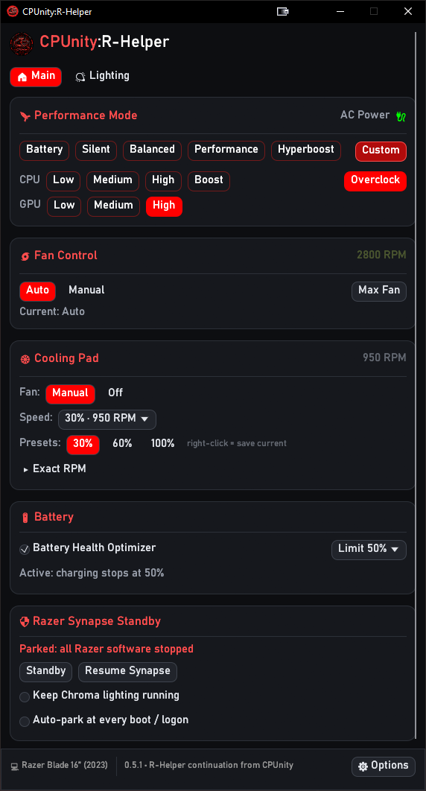
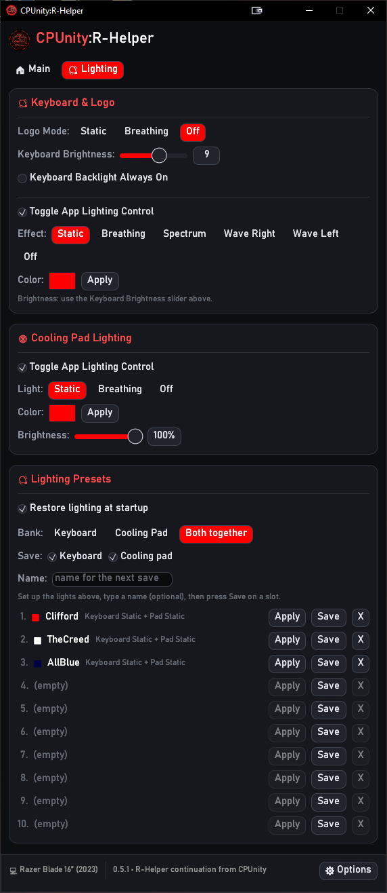

<p align="center">
  
</p>

# CPUnity:R-Helper

A small Windows app to control a Razer Blade **without Synapse**: performance modes, CPU/GPU boost,
fan control, keyboard and logo lighting, battery charge limit, and a built-in switch that parks
Razer Synapse so it stops fighting your power settings.

Fork of [R-Helper](https://github.com/Fatalution/r-helper) by Fatalution (MIT), which is built on
[razer-ctl](https://github.com/blauzim/razer-ctl)'s `librazer` (MIT).

<p align="center">
  
  &nbsp;&nbsp;
  
</p>
<p align="center"><sub>Main tab (left) and Lighting tab (right)</sub></p>

## Features

**Performance**
- Battery, Silent, Balanced, Performance, Hyperboost and Custom modes.
- In Custom: CPU and GPU boost presets, including CPU Overclock.
- AC / battery profile: pick a mode for each power source. An explicit choice is applied when the
  app starts and whenever you plug or unplug. "Default" keeps the original behaviour on plug /
  unplug (Performance on AC, Battery on battery) and leaves the current mode alone at launch.
- Optional "Overclock on AC power" (Custom mode + CPU Overclock).

**Fan**
- Auto or Manual with an RPM slider, live RPM readout, and a **Max Fan** button (Manual + slider
  at maximum, one click).

**Lighting and battery**
- Lid logo mode (Static, Breathing, Off), keyboard brightness, "backlight always on".
- All lighting lives on its own **Lighting** tab (click it next to Main), away from the main page.
- **Keyboard effects (opt-in).** Tick **Toggle App Lighting Control** to get Static, Breathing,
  Spectrum, Wave (both directions) and Off, plus a color picker. It is off by default: R-Helper
  only sends an effect when you click one, so Razer Chroma / Synapse stay in charge until you ask
  otherwise.
- **Lighting presets: 10 slots each for the keyboard, the cooling pad, and both together.** Set the
  lights up, optionally type a name, press **Save** on a slot; **Apply** brings it back. A "both"
  preset can hold the keyboard part, the pad part, or both. Presets live in `config.txt`, so they
  work with Synapse parked.
- **Restore lighting at startup (opt-in).** Off by default. When on, the last keyboard effect and
  pad lighting you applied are put back when the app starts (and when the pad is plugged in again),
  provided "Toggle App Lighting Control" is on for that device.
- **Battery Health Optimizer** with a charge limit from 50% to 80% in 5% steps.

**Razer Synapse Standby** (built in, so you no longer need a separate Synapse killer tool)
- **Standby** stops Synapse services, scheduled tasks, autostarts and processes. The laptop keeps
  the last settings that were applied.
- **Keep Chroma lighting running** leaves only the Chroma half of the Razer engine alive, so
  animated RGB keeps working.
- **Auto-park at every boot / logon** installs a startup task (`SynapseStandby-Guard`) that parks
  Synapse on every boot.
- **Resume Synapse** undoes everything Standby changed and removes the boot task.

**Cooling pad** (new, shown only when a Razer Laptop Cooling Pad is plugged in)
- Fan: Manual or Off. In Manual, pick a speed from a dropdown in 5% steps (15-100% of the pad's
  maximum, shown with the RPM), or use one of **three saved presets** (click to apply, right-click to
  save the current speed into that slot). An "Exact RPM" slider (500-3200 RPM) is tucked away for
  fine tuning.
- Your last fan setting is re-applied when the pad is plugged back in or the PC wakes from sleep.
- **Lighting is opt-in.** "Toggle App Lighting Control" is off by default: while it is off,
  R-Helper never opens or touches the pad's lights, so Razer Chroma / Synapse stay in charge. When
  you switch it on (Lighting tab) you get Static / Breathing / Off, color and brightness, and the
  lights only change when you click something there, or when you chose "Restore lighting at
  startup".

**Look**
- Dark card layout, resizable window that fits its content, selectable UI font.
- Accent color with presets, RGB boxes, hex, a visual picker and 10 saved colors.
- Optional `logo.png` and `banner.png` (see Custom images below).

## Supported models

The model is detected from the laptop's model number. The controls only work on these Blades:

| Model | Model number |
|---|---|
| Razer Blade 14 (2022) | RZ09-0427 |
| Razer Blade 15 (2022) | RZ09-0421 |
| Razer Blade 17 (2022) | RZ09-0423 |
| Razer Blade 14 (2023) | RZ09-0482 |
| Razer Blade 16 (2023) | RZ09-0483 |
| Razer Blade 16 (2025) | RZ09-0528 |
| Razer Blade 14 (2025) | RZ09-05306 |

**Tested on:** Razer Blade 16 (2023) only. The original R-Helper features should behave as upstream
on the other models, but the CPUnity additions (Synapse Standby, Max Fan, battery limit values,
launch profile) have not been tried there. Reports are welcome.

On an unsupported laptop the app starts but shows "No Razer Device" and the controls stay inactive.

## Install

1. Download the zip from the Releases page and extract it anywhere.
2. Run `cpunity-rhelper.exe`. No installer, no driver, no admin rights needed for normal use.
3. Windows SmartScreen may warn about an unsigned app. Choose **More info > Run anyway** if you
   trust the download.

Only the Synapse Standby buttons ask for administrator rights (a Windows UAC prompt).

## Build from source

Requires Windows and the stable Rust toolchain.

```
cargo build --release
```

Output: `target/release/cpunity-rhelper.exe`. The included GitHub Actions workflows also build it:
`build` on every push, and `release` when you push a tag such as `v0.5.0`.

## Synapse Standby in detail

Razer Synapse can re-apply its own power profile when it starts, which can override limits you set
elsewhere (for example Intel XTU), and it keeps background services running. Standby stops that.

- **Standby** (Keep Chroma unticked) kills the Razer processes and stops and disables every
  Razer service, scheduled task and autostart entry. Kernel drivers (`rz*.sys`) are not touched, so
  your keyboard and mouse keep working.
- **Keep Chroma lighting running** ticked leaves the Chroma half of the Razer engine alive and only
  parks a short list of services (Razer Experience Service, Game Manager, RGS and Chroma Stream
  Server). The Razer Elevation Service is left alone.
- Everything it changes is recorded in `C:\ProgramData\SynapseStandby\state.json`, so **Resume
  Synapse** can put it all back.
- The boot guard task runs as SYSTEM and uses its own copy of the script in
  `C:\ProgramData\SynapseStandby\`.
- Only settings stored in the laptop's firmware persist while Synapse is parked. Software-driven
  features (Chroma effects, macros, per-game profiles) need Synapse or the Chroma engine running.
- While fully parked, starting Razer apps by hand can cause repeated UAC prompts. Click **Resume
  Synapse** first.

To undo everything: click **Resume Synapse**. To remove the app's files: see below.

## Custom images and fonts

- **Banner**: `banner.png` (or `.jpg`) fills the header space right of the title. It is cropped
  from the center to fit. Options > Custom Image shows the exact size for your screen; a 7:1 image
  such as 1400 x 200 px works well. Keep key art centered.
- **Logo**: `logo.png` (or `.jpg`), a small square image shown left of the title.
- **Font**: choose one in Options, or select **Custom (font.ttf)** and place `font.ttf` / `font.otf`
  next to the exe.

Put the files next to the exe or in `%APPDATA%\CPUnity-R-Helper\`, then restart. To bake the logo and
banner into the exe, place `logo.png` / `banner.png` in the `assets/` folder and rebuild; a file
next to the exe still overrides the baked-in one.

## Where data is kept

| What | Where |
|---|---|
| Settings, log, saved colors | `%APPDATA%\CPUnity-R-Helper\config.txt`, `log.txt` |
| Synapse Standby state (written by Standby, removed by Resume) and the boot-guard script copy | `C:\ProgramData\SynapseStandby\` |
| Boot task (only with Auto-park) | Task Scheduler: `SynapseStandby-Guard` |
| Launch at startup | `HKCU\Software\Microsoft\Windows\CurrentVersion\Run`, value `CPUnity-R-Helper` |

To reset the app, close it and delete `config.txt`. Before deleting everything, click **Resume
Synapse** and untick "launch at startup" so the boot task and registry entry are removed too.

## Troubleshooting

- **Window laggy while Razer software runs**: Chroma and Synapse share the laptop's USB channel.
  The app backs off automatically, and parking Synapse removes the contention entirely.
- **Something looks wrong**: open `%APPDATA%\CPUnity-R-Helper\log.txt` and include it in a bug
  report. It records mode changes, slow device polls and Synapse actions.
- **Debug mode** (Options > Advanced) unlocks CPU/GPU combinations the firmware forbids and shows
  extra messages. Not saved; leave it off unless you know why you want it.

## Known limits

- The battery limit is written as a percentage register. 80% is the value Synapse itself uses.
  Every step (50 to 80% in 5% increments) was tested and holds on the Blade 16 (2023); on other
  models verify with a charge test before relying on it.
- **Raising the limit by a small step may not restart charging.** This is how the laptop's
  firmware behaves, not an app bug. Once the limit has been reached, charging only resumes after
  the battery has dropped about 10 points below the limit. Example: held at 70%, setting 80%
  starts charging (gap of 10), but going from 75% to 80% or from 55% to 60% (gap of 5) does
  nothing. To charge right away, set a limit at least 10 points above the current charge (80% is
  simplest), then lower it to the value you want; charging continues up to that value. Staying
  just under the limit is also normal: with an 80% limit the battery cycles between roughly
  70 and 80%.
- Keyboard effects use Razer's standard extended-matrix-effect command and are new; they are not
  yet confirmed on every Blade model. Wave and Spectrum ignore the picked color. If an effect
  ignores the color or looks choppy, try the "Keyboard effect tuning" switches in Options > Advanced
  and click the effect again; `log.txt` records which variant was sent.
- Cooling pad support is new and has only been tried with one pad (USB 1532:0F43). Fan "Auto"
  (temperature-driven) is not included yet; use Manual or Off.
- Balanced and Performance can have the same CPU wattage on some laptops; the difference may be
  only fans or GPU behaviour, set by the firmware, not by this app.

## Shoutouts

Huge thanks to everyone who made this possible:

- **[Fatalution](https://github.com/Fatalution/r-helper)** - R-Helper, the app this is built on (MIT).
- **[blauzim](https://github.com/blauzim/razer-ctl) and tdakhran** - razer-ctl / `librazer`, the
  device layer (MIT).
- **[razer-laptop-control-no-dkms](https://github.com/Razer-Linux/razer-laptop-control-no-dkms)
  contributors** - protocol groundwork.
- **[NxRoot](https://github.com/NxRoot/SynapseKiller)** - SynapseKiller, the idea behind Synapse
  Standby (keep your Razer settings without Synapse running in the background). Please support
  their project too: if Synapse Standby saves you time, give
  [SynapseKiller](https://github.com/NxRoot/SynapseKiller) a star on GitHub.
- **[Robak08](https://github.com/Robak08/r-helper)** - Razer Laptop Cooling Pad support in their
  R-Helper fork (MIT), the groundwork for the Cooling Pad card.
- **egui / eframe, image-rs, hidapi-rs, windows-rs, ab_glyph, strum, serde, anyhow, rand, clap,
  embed-resource** - the Rust crates that carry the app.
- **The Rust project and community.**
- **CPUnity** - the project and its vision.
- **Volk-Märchen:VonV_T** - testing, art direction, relentless bug-hunting.
- **Claude (Anthropic)** - development assistant.
- **ChatGPT (OpenAI)** - logo and banner art.

## License

MIT license, see [LICENSE](LICENSE), [NOTICE](NOTICE) and
[THIRD_PARTY_LICENSES.md](THIRD_PARTY_LICENSES.md). The upstream notices must stay with any copy.

CPUnity:R-Helper is an independent, unofficial project. It is not affiliated with, endorsed by,
or sponsored by Razer Inc. "Razer", "Synapse", "Chroma" and "Blade" are trademarks of Razer Inc.,
used here only to describe compatibility.
